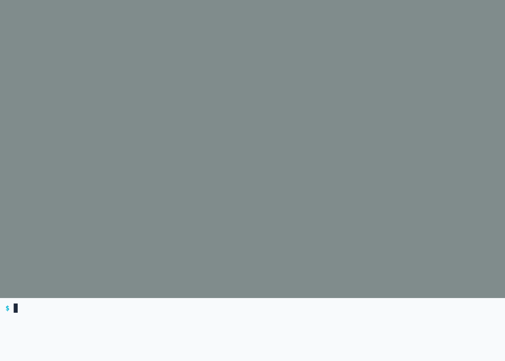
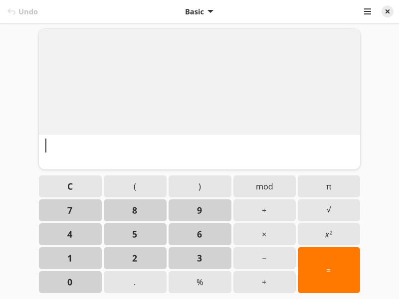
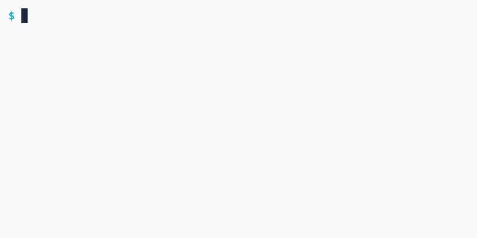
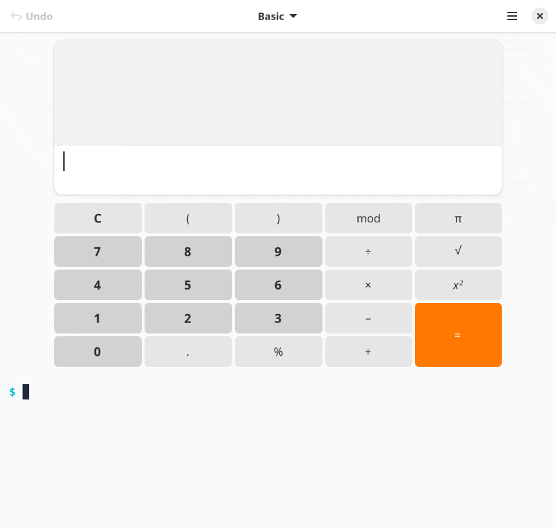
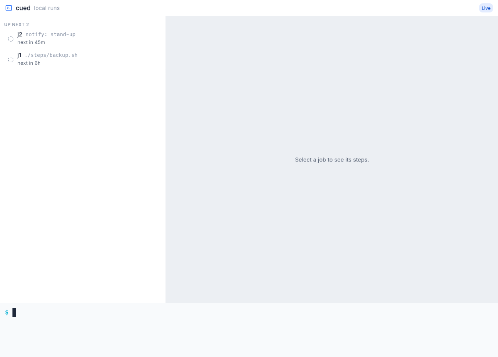

<p align="center">
  <picture>
    <source media="(prefers-color-scheme: dark)" srcset="docs/assets/banner-dark.jpg">
    
  </picture>
</p>

<p align="center">
  <b>README demos that keep up with your app.</b><br>
  Write the demo once as a script. matinee performs it against the real program, with seeded data and checked steps,
  and records light and dark GIFs with a camera that follows the action. Terminals, desktop apps, or both, on Linux.
</p>

<p align="center">
  <a href="https://github.com/RagingRedRiot/matinee/actions/workflows/ci.yml"></a>
  <a href="LICENSE"></a>
  
  
</p>

<p align="center">
  <a href="#install"><b>Install</b></a> ·
  <a href="#quick-start"><b>Quick start</b></a> ·
  <a href="#examples"><b>Examples</b></a> ·
  <a href="STORYBOARD.md"><b>Storyboards</b></a> ·
  <a href="docs/web.md"><b>Web pages</b></a> ·
  <a href="docs/x11.md"><b>X11 apps</b></a> ·
  <a href="SUPPORT.md"><b>Support</b></a>
</p>

<picture>
  <source media="(prefers-color-scheme: dark)" srcset="examples/matinee/matinee-dark.gif">
  
</picture>

- **Demos as code.** A storyboard is a TOML file beside your project, reviewed
  like any change. When the interface changes, run matinee again and the demo
  is current.
- **The real program.** matinee drives the actual app, terminal, or browser
  with real input. Seed steps set up the same data before every run.
- **Fails instead of recording something wrong.** Steps name the controls they
  use, and every `expect` is checked. A demo that no longer matches the app
  stops, and `--artifacts` saves the screen it stopped on.
- **A camera that follows the action.** It eases in on whatever is clicked,
  typed, or dragged, so small controls read clearly at README width, with
  captions, highlights, click ripples, and key badges.
- **Light and dark.** Recordings come in both themes by default, ready for a
  `<picture>` element like the one above.
- **Terminals, GUIs, and both at once.** GTK and libadwaita apps, terminal
  stories, a terminal pane beside a window, live web pages in a browser, and
  X11 apps through Xwayland.
- **Nothing personal on screen.** Each demo runs in a private headless session
  with its own compositor, so your files, windows, names, and logins stay out
  of the recording. No desktop session or GPU needed.

## Why matinee?

Hand-recorded demos go stale the day the interface changes, take a steady hand
to redo, and are never quite the same twice. Terminal tools have
[VHS](https://github.com/charmbracelet/vhs) for this. Desktop apps, and projects
that are part terminal, part GUI, have had nothing comparable. matinee is one
storyboard format and one command for both.

Like infrastructure as code, the demo is rebuilt rather than patched by hand.
Reproducible means the same steps, performed the same way, with their outcomes
checked. It does not mean byte-identical GIFs: live time labels, live sites,
and font rendering vary from run to run.

## Install

matinee runs on Linux with unprivileged user namespaces (on Ubuntu, see
`kernel.apparmor_restrict_unprivileged_userns`). It also needs what any desktop
that runs GTK or Qt already has: `dbus-daemon`, at-spi2-core, libpixman, and
libxkbcommon.

Download the latest release for x86_64 Linux (glibc 2.35 or newer):

```sh
base=https://github.com/RagingRedRiot/matinee/releases/latest/download
curl -fLO "$base/matinee-x86_64-linux.tar.gz" -O "$base/matinee-x86_64-linux.tar.gz.sha256"
sha256sum -c matinee-x86_64-linux.tar.gz.sha256
tar -xzf matinee-x86_64-linux.tar.gz matinee
install -D -m 755 -t ~/.local/bin matinee
```

Or build from source with Rust 1.87 or newer:

```sh
git clone https://github.com/RagingRedRiot/matinee
cd matinee
cargo install --path . --locked
```

Two dependencies are optional. Stories that opt into network access need
`pasta`, from the `passt` package, and apps launched with `x11 = true` need
Xwayland. Where user namespaces are not allowed, such as some CI runners,
`--no-isolation` runs stories on the host: they still get a fresh home,
environment, display, and buses, but can read your files and use the network.

## Quick start

A storyboard launches the app, then plays scenes of steps. This one, trimmed
from [`examples/calculator`](examples/calculator/demo.toml), clicks through a sum in
GNOME Calculator and checks the answer:

```toml
[demo]
output = "calculator"
size = [800, 600]

[launch]
app = "gnome-calculator"
wait_for = "="

[[scene]]
caption = "Click the buttons"
steps = [
  { click = "7" },
  { click = "+" },
  { click = "8" },
  { click = "=", hold = "1s" },
  { expect = "15", role = "text box" },
]
```

```sh
matinee check demo.toml         # read the storyboard and report mistakes, without running it
matinee run demo.toml           # perform it and check every step, without recording
matinee run --view demo.toml    # the same, watching the session and camera in a window
matinee record demo.toml        # perform it and write calculator-light.gif and calculator-dark.gif
matinee record                  # record every storyboard under this folder
```

When a step can't find its target, `matinee probe demo.toml` lists the windows
and the controls steps can name in them. [STORYBOARD.md](STORYBOARD.md) covers
every step, the camera, and terminal stories.

<details>
<summary>All commands and options</summary>

```sh
matinee check demo.toml                # report storyboard mistakes without running
matinee probe demo.toml                # list windows and what steps can target in them
matinee run demo.toml                  # perform and check every step, without recording
matinee record demo.toml               # perform it and write a GIF per theme
matinee record                         # record every storyboard under this folder
matinee snapshot demo.toml shot.png    # a picture of the screen once it settles
matinee shell demo.toml                # a shell inside the isolated session the demo gets

--view               # run, record: watch the session and camera in a window
--artifacts <dir>    # run, record: save a still at each check, and the failed screen
--fixed-too          # record: also write a fixed-camera GIF per theme
--stills             # record: also write a PNG after each highlight step
--no-isolation       # run on the host where user namespaces are unavailable
```

</details>

## Examples

| | |
| :---: | :---: |
| <a href="examples/calculator/demo.toml"></a><br>[**calculator**](examples/calculator/demo.toml): clicks and typing in GNOME Calculator | <a href="examples/terminal/demo.toml"></a><br>[**terminal**](examples/terminal/demo.toml): a staged `gh` command backed by a fixture |
| <a href="examples/mixed/demo.toml"></a><br>[**mixed**](examples/mixed/demo.toml): a terminal pane below an app window | <a href="examples/cued/demo.toml"></a><br>[**cued**](examples/cued/demo.toml): a release pipeline with a loop, a rollback, and a success |

More in [`examples/`](examples/):

- [**callboard**](examples/callboard/demo.toml): the demo in
  [callboard](https://github.com/RagingRedRiot/callboard)'s README. A script
  posts a feed, an item is dragged onto a board, and Ctrl+K jumps back after
  panning.
- [**matinee**](examples/matinee/demo.toml): the demo at the top of this page.
  A terminal runs the cued example with `--view`, and the viewport shows that
  run with its camera outlined.
- [**web-google**](examples/web-google/demo.toml): a live Google search
  recorded as a page-only demo in Firefox. Chrome, Vivaldi, and Brave were also
  tested; see [Recording a webpage](docs/web.md).

The callboard, cued, and matinee examples need those projects built in
checkouts beside this one.

## Privacy, not a sandbox

matinee runs each demo in an isolated session so that personal and identifying
details about you and your machine cannot end up in a recording: your files,
home folder, user and host names, other apps' windows, open sessions, and
logins. A demo shows only the project and what the storyboard sets up.

The isolation is not a sandbox for running untrusted or dangerous software. Do
not use matinee to detonate malware or contain anything malicious. It is not
built or tested to withstand a program trying to escape, and it would not hold
up as a safety net.

## Documentation

| | |
|---|---|
| [Storyboards](STORYBOARD.md) | Writing and checking a demo: sessions, launches, steps, assertions, the camera, and output |
| [Web pages](docs/web.md) | Recording a live site through a browser, with tested launch flags for Firefox, Chrome, Vivaldi, and Brave |
| [X11 apps](docs/x11.md) | Tk, Motif, and Qt apps through Xwayland, and Qt 5 accessibility on Wayland |
| [Agent skill](skills/matinee/SKILL.md) | Teaches an AI agent to write storyboards and run the check, probe, run, and record loop |
| [Support](SUPPORT.md) | Which toolkits and themes are verified, and the evidence behind each |
| [Vision](VISION.md) | Philosophy, goals, and what comes later |
| [Build decisions](BUILD-DECISIONS.md) | Working contracts, experiment results, and the architecture |

## Status

Linux x86_64 is the validated platform. See the [release notes](CHANGELOG.md)
for what each version changed. Video output and crates.io publication are
deferred.

## Contributing

Bug reports, focused fixes, example storyboards, support evidence for more
toolkits, and documentation improvements are welcome, including AI-assisted
contributions. Read the [contribution guide](CONTRIBUTING.md) for checks,
submission guidance, and review expectations. If something from your machine
shows up in a session or recording, follow the [security policy](SECURITY.md)
and report it privately.

## Development

```sh
cargo fmt --check
cargo clippy --locked --all-targets -- -D warnings
cargo test --locked
cargo test --locked -- --ignored --test-threads=1   # integration tests that need GTK, Xwayland, and pasta
```

CI runs these on every pull request, then records the terminal, calculator,
and mixed examples in both themes and saves the recordings, stills, and visual
differences for review. `controls.yml` holds back a pull request that changes
workflows, scripts, build files, the isolation boundary, or existing tests
until a maintainer applies the `reviewed-controls` label. The
[contribution guide](CONTRIBUTING.md#reviewing-recordings) covers reviewing
recordings locally.

Releases are cut from the Actions tab, and pull requests never change the
version. Notes for the next release collect under `## Unreleased` in
[CHANGELOG.md](CHANGELOG.md). **Prepare release** bumps the version to the next
patch, minor, or major on a `release/vX.Y.Z` branch, dates those notes, and
links to a pull request for it. Merging that pull request makes **Publish
release** tag the commit and start the release build, which checks that the
binary performs a story in a real isolated session before attaching it to a
GitHub release with the notes.

## License

[MIT](LICENSE)
